<p align="center">
  
</p>

<h3 align="center">The memory engine that knows <i>when</i> a fact was true, shows <i>where</i> it came from, and says "I don't know" when it doesn't.</h3>

<p align="center">
  A local-first, evidence-verifiable temporal memory engine for AI agents.<br/>
  No API key · no cloud · no Docker · one SQLite file · every claim backed by a reproducible benchmark
</p>

<p align="center">
  <a href="https://github.com/ParthivPandya/MemoraOS/actions/workflows/ci.yml"></a>
  <a href="https://opensource.org/licenses/Apache-2.0"></a>
  <a href="https://www.python.org/downloads/"></a>
  
  
  
  <a href="https://github.com/ParthivPandya/MemoraOS/stargazers"></a>
</p>

<p align="center">
  <a href="#quick-start"><b>Quick start</b></a> ·
  <a href="#the-evidence"><b>The evidence</b></a> ·
  <a href="#how-it-works">How it works</a> ·
  <a href="#dashboard">Dashboard</a> ·
  <a href="#examples">Examples</a> ·
  <a href="#limitations">Limitations</a> ·
  <a href="docs/EVIDENCE.md">Full evidence</a> ·
  <a href="docs/API.md">API</a>
</p>

---

## Proof at a glance

Measured on **real data**, scored by a mechanical judge (no LLM), regenerated by one command each. Full tables, questions and failures: [docs/EVIDENCE.md](docs/EVIDENCE.md).

<table>
  <tr>
    <td width="33%" align="center"><h2>21 / 21</h2><b>temporal questions answered</b><br/>on the real CPython release history (PEP 693 · 719 · 745). Best RAG baseline: <b>6 / 21</b>.</td>
    <td width="33%" align="center"><h2>83% vs 28%</h2><b>unanswerable questions refused</b><br/>on the project's own docs. MemoraOS refuses 15 of 18; RAG with an abstention gate refuses 5, plain RAG refuses none.</td>
    <td width="33%" align="center"><h2>4.6× fewer</h2><b>evidence tokens per answer</b><br/>143 vs 656 for the best RAG baseline, because MemoraOS returns the supporting sentences, not whole chunks.</td>
  </tr>
</table>

> **The honest half.** On real prose MemoraOS is *not* ahead of a well-tuned RAG baseline: overall accuracy is a statistical tie (60.9% vs 70.3% for RAG with an abstention gate, intervals overlap), and MemoraOS answers fewer answerable questions (24 of 46 vs 40 of 46). It trades recall for fewer wrong answers, and the dial is published. The synthetic benchmark is **saturated** (MemoraOS 100%) and no longer discriminates. See [Limitations](#limitations).

## Why

Vector search over chat history and documents fails in predictable ways: it returns last year's value next to this year's, mixes up sources that disagree, cannot say what was true on a given date, and answers confidently when memory is silent. MemoraOS treats each of those as a first-class requirement.

| The problem | What MemoraOS does |
|---|---|
| **Facts change.** | **Bitemporal facts** (valid time + recorded time). Nothing is overwritten. "Current", "previous" and "on a date" are different queries over the same facts. |
| **Sources disagree.** | **Contradiction analysis.** Version changes resolve; genuine conflicts are reported and never silently picked. |
| **Answers must be trusted.** | **Evidence on every answer** (source id, excerpt, effective date, reliability) and `insufficient_evidence` instead of a guess. |
| **Questions are different.** | An **adaptive router** picks exact, temporal, graph, episodic, procedural, BM25, vector, hybrid or evidence-fusion retrieval, and reports why. |
| **Memory must stay inspectable.** | Originals are never altered; consolidation only adds linked, reversible summaries. Compression never costs you the source. |
| **"What did the agent know on date D?"** | **Time travel** over versions and a hash-chained, tamper-evident event log. |
| **Privacy.** | Tenant and user isolation, secret redaction, hard delete, export, untrusted-data rendering against prompt injection. |

## Quick start

```bash
git clone https://github.com/ParthivPandya/MemoraOS.git && cd MemoraOS
python -m venv .venv && .venv\Scripts\activate          # Linux/macOS: source .venv/bin/activate
pip install -e ".[dev,api]"
```

The snippet below uses only real data that ships in this repository: the project's security document and the CPython release history copied from three PEPs.

```python
import json
from pathlib import Path

from memoraos import MemoryOS

memory = MemoryOS.local()  # one SQLite file in ./.memoraos: no network, no API key
me = "me"

# 1. A real document, stored as written
memory.remember(Path("docs/SECURITY.md").read_text(encoding="utf-8"), user_id=me, source_type="document", origin="docs/SECURITY.md")

# 2. Real dated facts: the CPython release history from PEP 693, 719 and 745
for rec in json.loads(Path("data/python_releases.json").read_text(encoding="utf-8"))["records"]:
    memory.remember_json({k: rec[k] for k in ("subject", "predicate", "object", "valid_from")}, user_id=me, origin=rec["source"])

for question in (
    "Is encryption at rest implemented in code?",
    "What is the latest version of Python 3.14?",
    "What was the latest version of Python 3.14 in March 2026?",
    "What was the latest stable version of Python before October 2024?",
    "Which Kubernetes version does MemoraOS require?",
):
    r = memory.recall(question, user_id=me)
    print(f"{question}\n  {r.status} | {r.strategy} | {r.answer}")
    if r.evidence:
        e = r.evidence[0]
        print(f"  evidence: {e.kind} | source_type={e.source_type} | reliability={e.source_reliability} | effective={e.effective_at}")
```

Real output of that script, unedited:

```text
Is encryption at rest implemented in code?
  answered | hybrid | - **Encryption at rest** is not implemented in code.
  evidence: passage | source_type=document | reliability=0.7 | effective=None
What is the latest version of Python 3.14?
  answered | exact | 3.14.10
  evidence: fact | source_type=structured | reliability=0.85 | effective=2026-10-26T00:00:00.000000Z
What was the latest version of Python 3.14 in March 2026?
  answered | temporal | 3.14.3
  evidence: fact | source_type=structured | reliability=0.85 | effective=2026-02-03T00:00:00.000000Z
What was the latest stable version of Python before October 2024?
  answered | temporal | 3.12 (effective 2023-10-02)
  evidence: fact | source_type=structured | reliability=0.85 | effective=2023-10-02T00:00:00.000000Z
Which Kubernetes version does MemoraOS require?
  insufficient_evidence | vector | The stored memory does not establish an answer to this question.
```

Four things happened there: the same engine answered from a **document** and from **dated facts**; it picked a different strategy for each question (`hybrid`, `exact`, `temporal`); every answer carries the evidence that supports it; and the question about something the documents never mention was **refused** instead of invented. Answers from documents are extractive passages, as written.

Also available: `explain()`, `history()`, `recall(as_of=...)`, `correct()`, `forget()`, `consolidate()`, `reflect()`, `evaluate()`. Full reference: [docs/API.md](docs/API.md).

<details>
<summary><b>Run everything</b> (API, tests, benchmarks, dashboard, MCP, SDK, examples)</summary>

```bash
memoraos keys create --tenant default --role admin     # prints an API key once
memoraos serve                                         # REST API on http://127.0.0.1:8000 (docs at /docs)
python -m pytest                                       # 284 tests
python -m benchmarks.real_docs                         # real documentation benchmark
python -m benchmarks.real_temporal                     # real PEP release-date benchmark
python -m benchmarks.run                               # synthetic suite, about 2 minutes
python scripts/make_figures.py                         # regenerate every figure in docs/assets from the reports
python examples/temporal_memory/main.py                # also: basic_memory, hybrid_rag, multi_agent, research_memory
cd apps/dashboard && copy .env.example .env.local && npm install && npm run dev      # http://localhost:3000
cd sdk/typescript && npm install && npm test           # TypeScript SDK
MEMORAOS_USER_ID=user_001 memoraos mcp                 # MCP server over stdio
```

Put the API key printed above into `MEMORAOS_API_KEY` in `apps/dashboard/.env.local`. The dashboard keeps it server-side. To fill the dashboard with the same real data used in the screenshots below: `python scripts/seed_real.py <api-url> <api-key>`.

</details>

## The evidence

Three benchmarks, two of them on real data. Each one is a command you can run, and each report lists the questions, the data and the failures. The point of publishing the losing rows is that a number you cannot check is not worth much.

### 1. Real dated data: change over time

[`benchmarks/real_temporal.py`](benchmarks/real_temporal.py) · 14 real dated release records from [PEP 693](https://peps.python.org/pep-0693/), [719](https://peps.python.org/pep-0719/) and [745](https://peps.python.org/pep-0745/) · 21 questions (current, previous, "on this date", and unanswerable), gold answers computed from the real dates.

| System | Accuracy [95% CI] | current | previous | on a date | unanswerable |
|---|---|---|---|---|---|
| BM25 RAG | 4.8% [0, 14.3] | 0% | 0% | 7.1% | 0% |
| Vector RAG | 28.6% [9.5, 47.6] | 0% | 0% | 42.9% | 0% |
| Hybrid RAG | 19.0% [4.8, 38.1] | 0% | 0% | 28.6% | 0% |
| Hybrid RAG + abstention gate | 19.0% [4.8, 38.1] | 0% | 0% | 28.6% | 0% |
| MemoraOS forced to hybrid retrieval | 33.3% [14.3, 52.4] | 0% | 0% | 28.6% | 100% |
| **MemoraOS** | **100%** [100, 100] | **100%** | **100%** | **100%** | **100%** |

A retriever sees ten near-identical sentences and cannot know which is current. MemoraOS orders facts by effective date, so the three question types are three different queries over the same facts. Forcing it back to plain retrieval removes the advantage, so the gain comes from the temporal fact engine, not the search primitives. *Small set, one fact family, templated sentences: this checks the mechanism on real dates, not general superiority.*

### 2. Real documentation: precision against recall

[`benchmarks/real_docs.py`](benchmarks/real_docs.py) · the project's own docs (26 files, 122 sections, used as written) · 46 answerable + 18 unanswerable questions, a dev set and a **held-out** set written before any fix · integrity checks abort the run if a gold answer is missing from the corpus, an "unanswerable" term is present, or a question is quoted in the corpus.

<p align="center">
  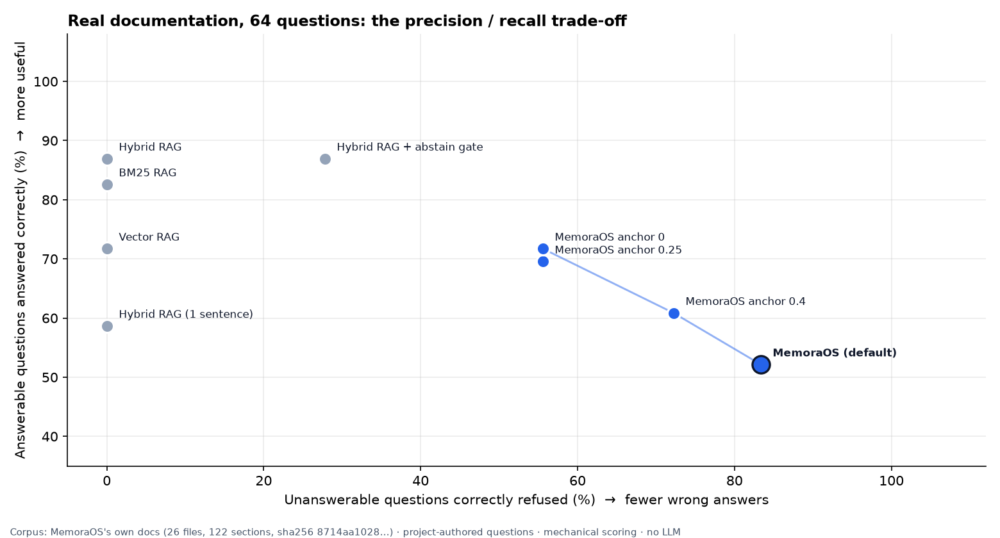
</p>

| System | All 64 [95% CI] | Answerable answered (46) | Unanswerable refused (18) | Held-out (22) | Evidence tokens |
|---|---|---|---|---|---|
| Hybrid RAG | 62.5% [51.6, 73.4] | 87.0% | 0% | 68.2% | 705 |
| Hybrid RAG + abstention gate | **70.3%** [59.4, 79.7] | **87.0%** | 27.8% | **81.8%** | 656 |
| **MemoraOS (default)** | 60.9% [48.4, 73.4] | 52.2% | **83.3%** | 59.1% | **143** |
| MemoraOS, looser `min_anchor_coverage=0.25` | 65.6% [54.7, 76.6] | 69.6% | 55.6% | 59.1% | 201 |

The systems fail in opposite ways: RAG answers almost everything, including questions the documents never address; MemoraOS answers less and is wrong less. Neither dominates, so the position on that curve is a published setting (`min_anchor_coverage`), not a hidden one. Every answer here is an **extractive passage**, and three of the 18 unanswerable questions were still wrongly answered ([the list](docs/EVIDENCE.md#what-memoraos-actually-returned)).

**The benchmark found real bugs.** MemoraOS scored 35.7% on the dev set the first time. Diagnosing it with `explain()` exposed a negation guard that dropped whole sections, answers limited to one sentence, an over-strict attribute guard, a mis-routed temporal cue and mid-sentence chunk overlap, several of them regressions from earlier v0.2 work. Each has a regression test ([`tests/unit/test_real_text_regressions.py`](tests/unit/test_real_text_regressions.py)) and the dev score went 35.7% → 61.9% (held-out 50.0% → 59.1%). The temporal benchmark then found two more (a version-qualified subject matching the unqualified subject's facts, and a passage without the named version still answering). All listed in [docs/RETRIEVAL.md](docs/RETRIEVAL.md).

### 3. Synthetic suite: a regression guard, saturated

`python -m benchmarks.run` · 19 generated scenarios × 3 seeds · digest `6a27829d09a1`.

<p align="center">
  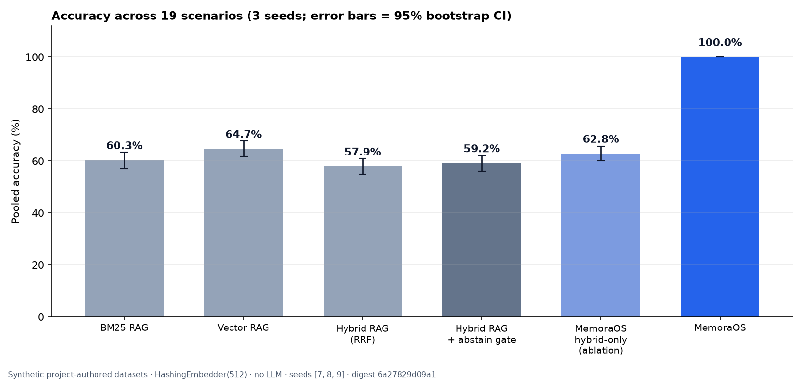
</p>

MemoraOS scores 100% in every scenario, and the RAG baselines score 58-65%. **Because the same authors wrote the datasets and the system, a perfect score means the suite no longer discriminates**; it still fails loudly when a mechanism regresses, and it is how the temporal, update, contradiction, multi-hop and abstention mechanisms are checked. It is not evidence of general superiority, which is why the two real-data benchmarks above exist. Scenario heatmap, degradation curve and cost chart: [REPORT.md](benchmarks/reports/REPORT.md).

<details>
<summary><b>Scenario heatmap and cost</b></summary>

<p align="center">
  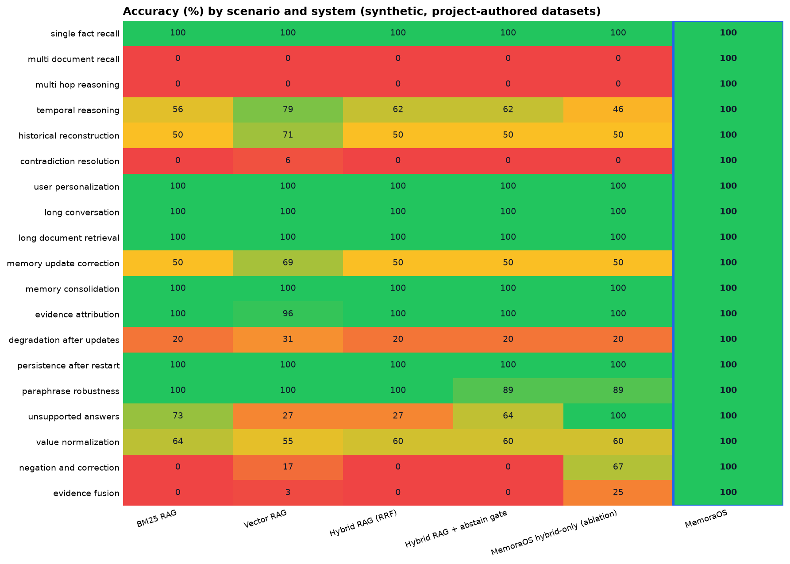
</p>
<p align="center">
  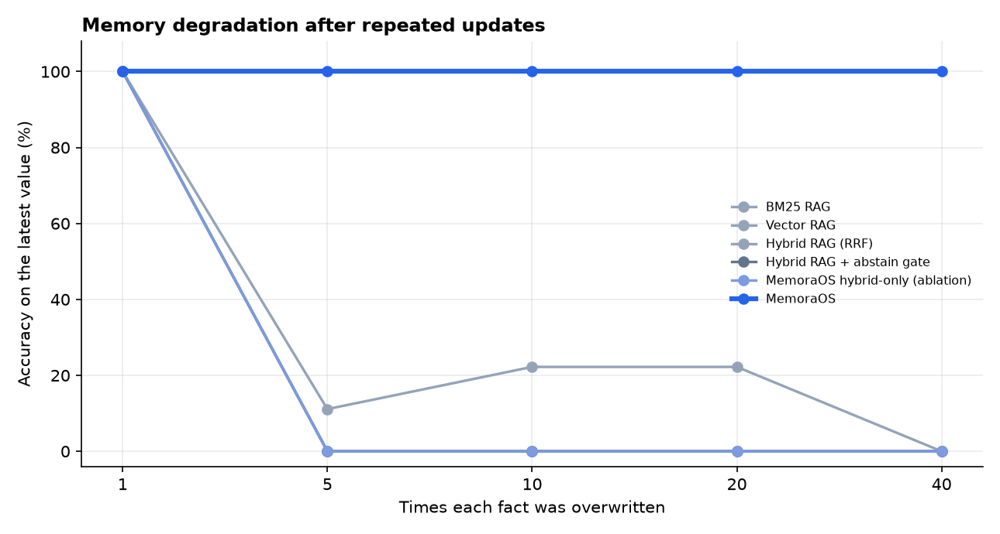
</p>
<p align="center">
  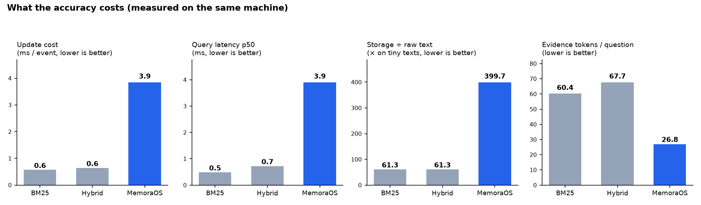
</p>

The accuracy has a price: more work per write and per query, and a larger store on small texts. Absolute timings vary by machine; read the ratios in the [report](benchmarks/reports/REPORT.md).

</details>

> **Not measured:** the optional LLM extractor, neural embedders, rerankers, and every external system (Mem0, Graphiti, Hindsight, Memorilla). The default embedder is lexical feature hashing. Method and scoring rules: [docs/BENCHMARK_METHODOLOGY.md](docs/BENCHMARK_METHODOLOGY.md).

## How it works

### Architecture

<p align="center">
  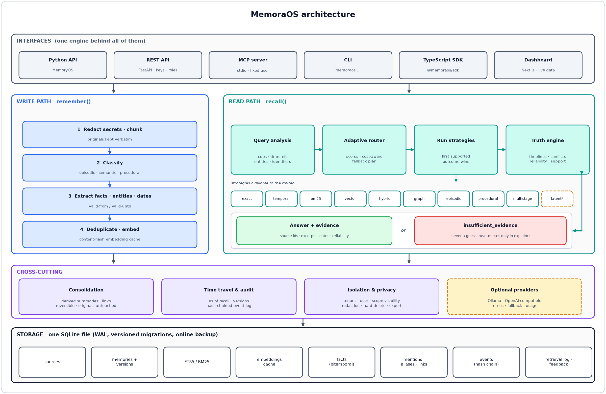
</p>

One engine sits behind every interface (Python, REST, MCP, CLI, TypeScript SDK, dashboard). **Writes** go through redaction, chunking, classification, grounded fact/entity/date extraction, deduplication and cached embedding. **Reads** go through query analysis, the router, one or more retrieval strategies and the truth engine, and end either in an answer with evidence or in `insufficient_evidence`. Everything persists in a single SQLite file. Details, schema and risk register: [docs/ARCHITECTURE.md](docs/ARCHITECTURE.md).

### Adaptive routing

A deterministic router scores each question, picks the cheapest strategy among the best, and lists fallbacks. The decision is returned on every result (`plan`, `strategies_tried`) and explained by `explain(recall_id)`. The figure below was produced by running the real router on a store holding the project's docs and the PEP release data.

<p align="center">
  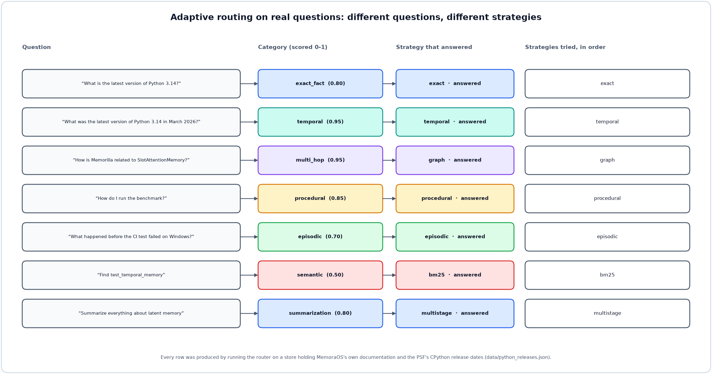
</p>

Strategies run in order until one produces *supported* evidence. Feedback-driven learning exists but is **off by default** and cannot trade accuracy for cost. See [docs/ADAPTIVE_ROUTING.md](docs/ADAPTIVE_ROUTING.md).

### Temporal memory

<p align="center">
  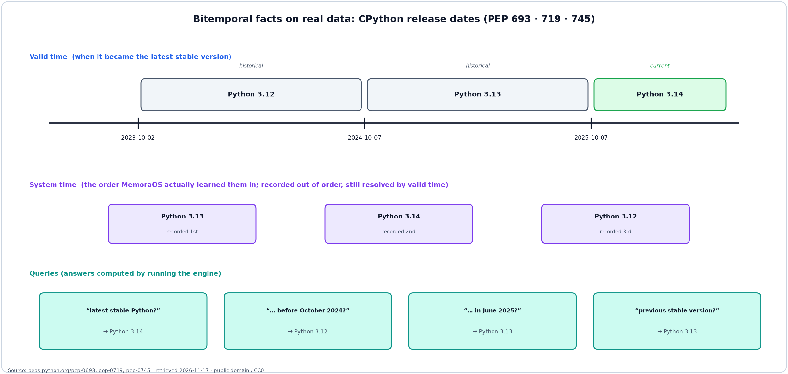
</p>

Facts carry *valid time* (when they were true) and *system time* (when MemoraOS learned them). The figure records the three releases in a deliberately shuffled order and the answers still resolve by valid time; the answers shown were computed by the engine. `as_of=` reconstructs only what had been recorded by then. Rules for conflicts, version changes and reliability: [docs/TEMPORAL_MEMORY.md](docs/TEMPORAL_MEMORY.md).

### Evidence fusion

Questions that chain several facts ("which region does the project this person manages run in?") are answered by a bounded, typed path search over stored facts. Every step must be a stored fact with a source memory, followed in the right direction; a missing or contradicted step yields `insufficient_evidence` or `conflict`, never a plausible guess. Confidence is the minimum over the steps. See [docs/RETRIEVAL.md](docs/RETRIEVAL.md).

### Memory types

Episodic (what happened), semantic (facts, preferences), procedural (how-to), temporal (values over time), relational (entity graph, multi-hop) and latent (experimental, see below). Design details: [docs/MEMORY_DESIGN.md](docs/MEMORY_DESIGN.md).

## Dashboard

A Next.js dashboard renders **live data from the REST API**; the API key never reaches the browser. The screenshots below were captured from a real instance holding the project's own documentation (122 sections) and the 14 PEP release facts, after asking 68 real questions (`scripts/seed_real.py`, `scripts/capture_dashboard.py`).

<table>
  <tr>
    <td width="50%">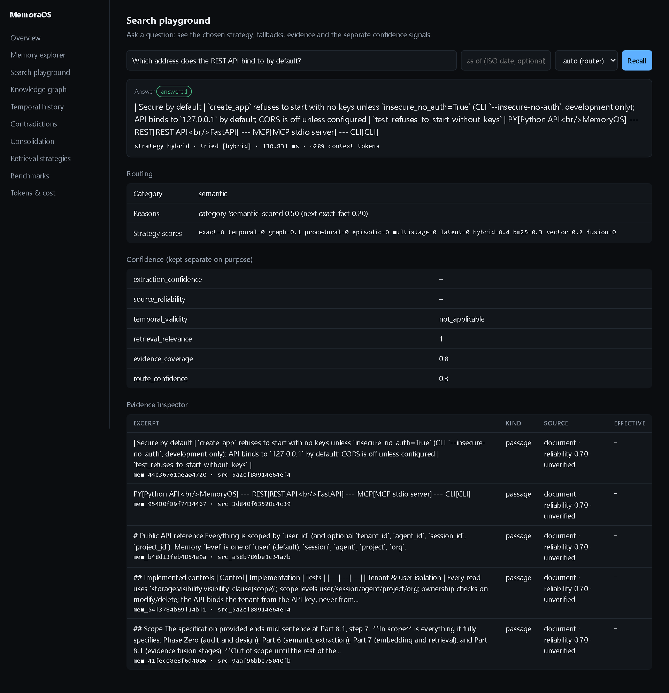<br/><sub><b>Search playground:</b> strategy, separate confidence signals and the evidence behind one answer. The answer is an extractive passage, so it can be a table row quoted as written.</sub></td>
    <td width="50%">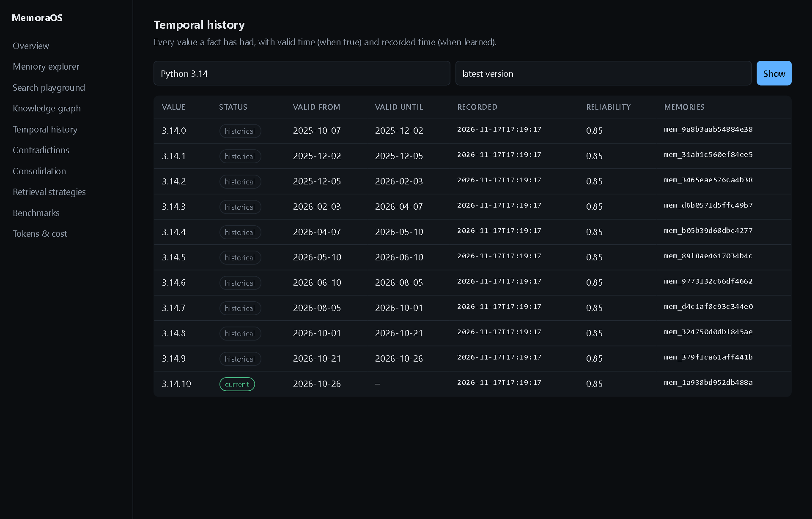<br/><sub><b>Temporal history:</b> every value a real fact has had, with valid time and recorded time.</sub></td>
  </tr>
  <tr>
    <td>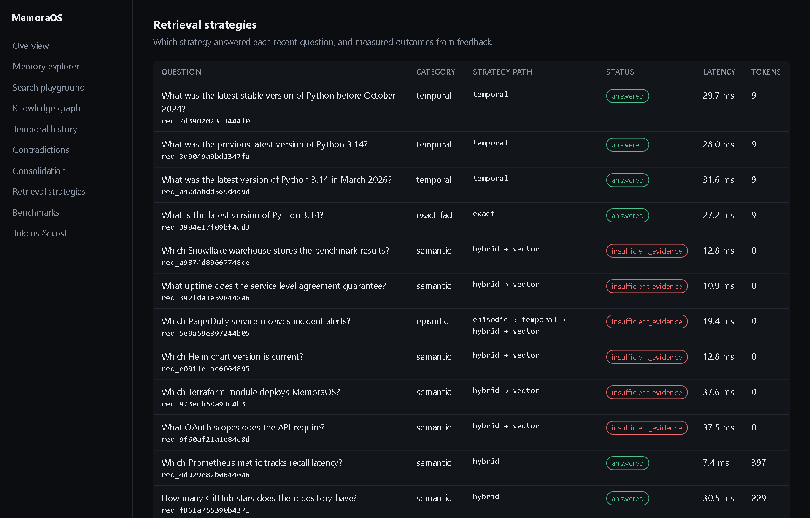<br/><sub><b>Retrieval strategies:</b> which path answered each question; refusals show as <code>insufficient_evidence</code> with 0 context tokens.</sub></td>
    <td>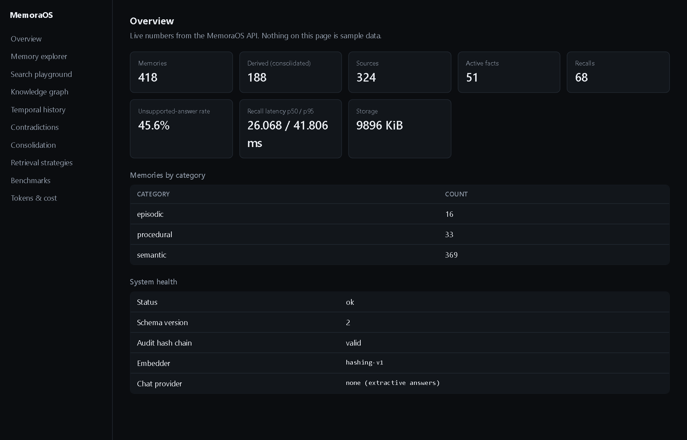<br/><sub><b>Overview:</b> counts, latency, audit-chain health and the unsupported-answer rate measured from judged feedback.</sub></td>
  </tr>
</table>

The contradiction explorer is empty on this data because none of the real facts conflict, and the knowledge-graph view is noisy on raw prose; both are shown as they are in [docs/EVIDENCE.md](docs/EVIDENCE.md#4-a-real-limit-shown).

## Examples

Every example runs on real data (the project's own documents and the PEP release history) and is covered by an integration test.

| Example | What it shows |
|---|---|
| [`basic_memory`](examples/basic_memory/main.py) | Store real decision records, ask with evidence, restart, and see an unsupported question refused. |
| [`temporal_memory`](examples/temporal_memory/main.py) | Current, previous, "on a date" and full history over the real CPython release dates. |
| [`hybrid_rag`](examples/hybrid_rag/main.py) | Chunked ingestion of one long real document, routing, forced strategies and `explain()`. |
| [`multi_agent`](examples/multi_agent/main.py) | Private, project, agent and org scopes with isolation between tenants. |
| [`research_memory`](examples/research_memory/main.py) | Many notes, a connection question, consolidation that keeps the originals, and reflection. |

## Compared with other systems

Documented capabilities only; "not documented" means we did not find it in the primary sources, not that it is absent. Sources, licenses and unverified claims: [docs/RESEARCH_AND_COMPETITIVE_ANALYSIS.md](docs/RESEARCH_AND_COMPETITIVE_ANALYSIS.md).

| | Local, no key, no server | Bitemporal facts | Contradiction reporting | Abstention measured | Learned latent memory |
|---|---|---|---|---|---|
| **MemoraOS** | yes | yes (rule-based extraction) | yes | yes | experimental baseline only |
| Mem0 | needs an LLM | partial | no | not documented | no |
| Graphiti / Zep | needs LLM + graph DB | yes (core strength) | invalidation | not documented | no |
| Hindsight | yes with a local LLM | time-range recall | beliefs | not documented | no |
| Memorilla | needs Linux + CUDA GPU | none documented | none documented | no | **yes (the reference)** |

Those projects are mature and often stronger at semantic extraction. MemoraOS's niche is local, inspectable, temporally correct memory that abstains. **MemoraOS is not Memorilla**: its latent-memory module is an interface plus a CPU k-means baseline, with no trained module and no claimed benefit ([docs/LATENT_MEMORY.md](docs/LATENT_MEMORY.md)).

## Limitations

Read these before relying on MemoraOS.

- **On real prose it is not ahead of RAG.** It ties on accuracy, answers fewer answerable questions and refuses more unanswerable ones ([evidence](docs/EVIDENCE.md)). Its advantage is concentrated in questions about change over time, and in abstention.
- **The synthetic benchmark is saturated** and project-authored. The real-data benchmarks are small and project-authored too (64 and 21 questions, wide confidence intervals); no independent benchmark has been run.
- **Fact extraction is deterministic English rules by default.** v0.2 handles negation, corrections, conjunctions and value normalization, and offers an optional LLM extractor whose output is grounded and validated against the source text. That LLM path is tested only with scripted fakes; its quality on real models is **unmeasured**. Implicit statements still need it.
- **Answers are extractive passages**, not written prose; they can include neighbouring sentences or a table row. `synthesize=True` with a chat provider gives fluent text, but that path is not benchmarked.
- **Default embeddings are lexical** (feature hashing). `OllamaEmbedder`, `OpenAICompatEmbedder` and `SentenceTransformerEmbedder` exist but are not benchmarked; entity/exact retrievers, query expansion and reranking are off by default because none improved the full pipeline in the ablation.
- **Latent memory** is an interface plus a CPU baseline. No Memorilla reproduction exists in this repository.
- Brute-force vector search (fine to roughly 10⁵ memories), no encryption at rest in code, and backups are not rewritten on delete. See [docs/SECURITY.md](docs/SECURITY.md) and [docs/PERFORMANCE.md](docs/PERFORMANCE.md).
- **Test data.** Unit and integration tests and the synthetic benchmark generators use controlled inputs by necessity. They are fixtures, not evidence.
- The CI workflow is defined in `.github/workflows` but had not run on GitHub when this was written; the same commands pass locally.

## Documentation

[Evidence](docs/EVIDENCE.md) · [Architecture](docs/ARCHITECTURE.md) · [API](docs/API.md) · [Memory design](docs/MEMORY_DESIGN.md) · [Adaptive routing](docs/ADAPTIVE_ROUTING.md) · [Temporal memory](docs/TEMPORAL_MEMORY.md) · [Extraction](docs/EXTRACTION.md) · [Retrieval](docs/RETRIEVAL.md) · [Latent memory](docs/LATENT_MEMORY.md) · [Benchmark methodology](docs/BENCHMARK_METHODOLOGY.md) · [Research](docs/RESEARCH_AND_COMPETITIVE_ANALYSIS.md) · [Security](docs/SECURITY.md) · [Performance](docs/PERFORMANCE.md) · [Roadmap](docs/ROADMAP.md) · [Implementation status](docs/IMPLEMENTATION_STATUS.md) · [v0.2 architecture](docs/V02_ARCHITECTURE.md) · [Changelog](CHANGELOG.md) · [ADRs](docs/ADR)

## Contributing

See [CONTRIBUTING.md](CONTRIBUTING.md) and the [Code of Conduct](CODE_OF_CONDUCT.md). The most valuable contributions are the ones that make MemoraOS look bad: a benchmark question it answers wrongly, a real document it mis-extracts, an external-system adapter that really runs. Add them with the real source text and they become regression tests. Report vulnerabilities privately: [SECURITY.md](SECURITY.md).

## License

[Apache-2.0](LICENSE)
