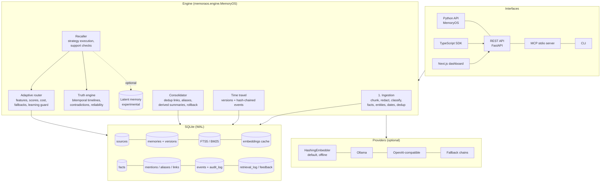

# Architecture

MemoraOS is a single-process, SQLite-first memory engine. Everything runs locally with no network or API key; model providers are optional adapters.

## Layers

| Layer | Module | Responsibility |
|---|---|---|
| Ingestion | `memoraos.ingestion`, `engine.remember*` | Redact secrets, chunk, classify (episodic / semantic / procedural), extract facts, entities and dates, detect exact duplicates, embed (cached), preserve originals |
| Storage | `memoraos.storage`, `memoraos.store` | Versioned migrations, transactions, WAL, backup API, tenant visibility clause, hash-chained event log |
| Intelligence | `memoraos.retrieval`, `memoraos.truth` | BM25 (FTS5), cosine vectors, RRF, fact slots, graph traversal, bitemporal timelines |
| Routing | `memoraos.routing` | Query features → category → strategy plan with fallbacks; guarded feedback learning |
| Truth & consolidation | `memoraos.truth`, `memoraos.consolidation` | Contradiction handling, evidence checks, consolidation with rollback |
| Interfaces | `memoraos.api`, `memoraos.mcp`, `memoraos.client`, `sdk/typescript`, `apps/dashboard` | REST, MCP, SDKs, UI |
| Evaluation | `memoraos.evaluation`, `benchmarks/` | Metrics and the reproducible benchmark lab |

## Request flow for `recall(query)`

1. Build a `Scope` (tenant, user, optional agent/session/project). Every SQL read goes through `visibility_clause(scope)`.
2. `analyze_query` extracts features (exact/temporal/multi-hop/procedural/episodic/summary cues, time references, entity terms, code-like tokens).
3. `RouterHints` from the store (does a fact slot match? how many graph entities? procedural memories exist?) sharpen routing.
4. `AdaptiveRouter.route` scores categories, picks a strategy within a cost tolerance, and appends fallbacks.
5. The `Recaller` runs strategies in order until one produces **supported** evidence; otherwise the answer is `insufficient_evidence`.
6. The outcome (plan, attempts, timeline, contradictions, evidence, separate confidence signals) is written to `retrieval_log` for `explain()` and analytics.

## Component contracts

- `EmbeddingProvider.embed(list[str]) -> (n, dim) float32, L2-normalised`
- `ChatProvider.complete(messages, max_tokens) -> ChatResponse(text, usage)` (optional; only for routing assist and answer phrasing)
- `RerankProvider.rerank(query, docs) -> list[float]`, `EntityExtractor.extract(text) -> ExtractedEntities`
- `LatentMemoryBackend.fit / readout / retrieve / stats` (see [LATENT_MEMORY.md](LATENT_MEMORY.md))
- Retrieval strategy ⇒ `Outcome(status, answer, evidence, timeline, contradictions, coverage, notes)`

## Database schema (migration 1)

| Table | Purpose |
|---|---|
| `sources` | Original text exactly as submitted (after secret redaction), type, origin, reliability, verification, optional file copy |
| `memories` | Chunk-level memory: original + normalized content, category, scope, status, version, derived flag, importance, mention count, `duplicate_of`, embedding reference |
| `memory_versions` | Every version of a memory's text (supports corrections and as-of reads) |
| `memory_provenance` | Extra sources that restated an existing memory |
| `embeddings` | Vector cache keyed by `(content_hash, model)` |
| `memories_fts` | FTS5 (Porter) index for BM25 |
| `facts` | `(subject, predicate, object)` with `valid_from/valid_until` (valid time) and `recorded_at/retracted_at` (system time), extraction confidence, source reliability |
| `mentions`, `aliases`, `memory_links` | Entity mentions (graph), reversible entity-resolution aliases, derived-from / near-duplicate links |
| `events` | Append-only change log with `prev_hash`/`hash` chain (tamper evident) |
| `audit_log` | API actions (actor = key fingerprint, never the key) |
| `retrieval_log`, `feedback` | What was asked, how it was routed and answered; user/ground-truth feedback |
| `consolidation_runs` | Per-run report, watermark for incremental runs, rollback marker |
| `provider_usage` | Tokens, cost and latency for provider calls |

**Migrations.** `storage/db.py::MIGRATIONS` is an ordered list applied once each inside a transaction and recorded in `schema_migrations`. Never edit an applied migration; append a new one. **Backup:** `MemoryOS.backup(path)` / `memoraos backup <path>` uses SQLite's online backup API.

## Technology decisions

| Decision | Choice | Why |
|---|---|---|
| Persistence | SQLite + FTS5 (WAL) | Zero infrastructure, transactional, ships with Python |
| Vector index | Brute-force cosine over a cached NumPy matrix | Exact, deterministic, fine to ~10⁵ memories; FAISS / sqlite-vec / pgvector are adapters for later |
| Graph | NetworkX built on demand from facts + mentions | Simple; tenant filtering happens in SQL before the graph is built |
| Default embedder | Feature-hashing (lexical) | Offline, deterministic, free; neural embedders plug in via the provider interface |
| Answers | Extractive and fact-based, LLM phrasing optional and verified against evidence | Prevents fabrication; works with no model |
| Time | Fixed-width UTC ISO strings | Lexicographic order = chronological order, indexable |
| IDs / clock | Injectable | Deterministic tests and benchmarks |

## Risk register

| Risk | Impact | Mitigation | Status |
|---|---|---|---|
| Rule-based extraction misses phrasings | Fact engine abstains or falls back to passages | Evidence guard prefers abstaining; `EntityExtractor` plug-in; paraphrase benchmark tracks it | Open (measured) |
| Lexical default embedder | Weak paraphrase recall | Provider adapters; documented | Open |
| Storage overhead on tiny texts (≈350× raw text in benchmark) | Disk use | Amortises with larger documents; embeddings cache is deduplicated | Accepted, measured |
| Prompt injection in stored text | Hijacked downstream LLM | Untrusted-data rendering, tag neutralisation, injection flags, sentences skipped from answers | Mitigated, tested |
| Cross-tenant leakage | Severe | Single visibility clause for every query; tests per endpoint | Mitigated, tested |
| Synthetic benchmark ≠ real data | Overclaiming | Methodology states limits; roadmap adds LoCoMo / LongMemEval adapters | Open |
| Hard delete vs. backups | Deleted data persists in old backups | Documented in [SECURITY.md](SECURITY.md) | Accepted |
