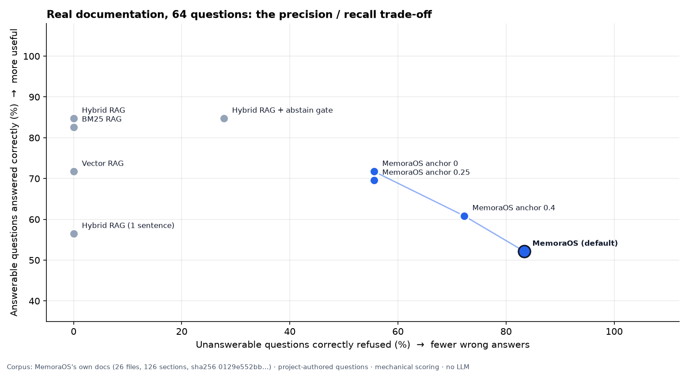
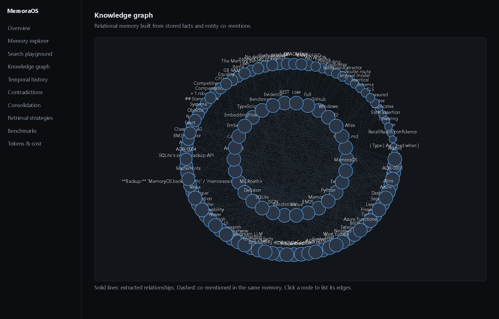

# Evidence

Everything on this page was produced by code in this repository and can be regenerated with the commands at the end. No number is hand-edited, and the questions, the data and the wins **and the losses** are all shown.

## Read this first

| Question | Answer |
|---|---|
| Is there generated data behind the headline numbers? | **Two of the three benchmarks use real data.** Real documentation (`benchmarks/real_docs.py`) and real dated CPython releases from three PEPs (`benchmarks/real_temporal.py`). The third (`benchmarks/run.py`) is a **synthetic** suite, kept as a regression guard. |
| Does MemoraOS beat RAG on real prose? | **No.** On real documentation MemoraOS is level with plain RAG and behind a RAG baseline with an abstention gate on how many answerable questions it answers. It refuses unanswerable questions far more often and uses about 4.6x fewer evidence tokens. |
| Where does it clearly win? | Questions about **change over time** on real dated data (21 of 21 against 19% for the best RAG baseline) and **abstention** on unanswerable questions. |
| Who judged the answers? | A mechanical judge (string containment and ID matching). No LLM anywhere. |
| What is not measured? | The optional LLM extractor, neural embedders, rerankers and every external system (Mem0, Graphiti, Hindsight, Memorilla). |

The unit and integration tests, and the synthetic benchmark generators, use controlled invented inputs by necessity: a test needs to know the right answer in advance. They are test fixtures, not evidence.

## 1. Real documentation (46 answerable + 18 unanswerable questions)

Corpus: this repository's own documentation, 26 Markdown files split by heading into 126 sections (123,552 characters, SHA-256 `0129e552bb6b…`), used exactly as written. Questions were written by the project. 30 + 12 are a **dev set** used to find defects; 16 + 6 are a **held-out set** written before any fix. The run aborts if a gold string is missing from the corpus, if an "unanswerable" term does occur in it, or if a question is quoted verbatim in the corpus.

<p align="center"></p>

| System | All 64 [95% CI] | Answerable answered correctly (46) | Unanswerable refused (18) | Held-out (22) | Evidence tokens / question |
|---|---|---|---|---|---|
| BM25 RAG | 59.4% [48.4, 70.3] | 82.6% | 0.0% | 59.1% | 745 |
| Vector RAG | 51.6% [40.6, 64.1] | 71.7% | 0.0% | 63.6% | 704 |
| Hybrid RAG | 60.9% [50.0, 71.9] | 84.8% | 0.0% | 63.6% | 714 |
| Hybrid RAG + abstention gate | **68.8%** [57.8, 78.1] | **84.8%** | 27.8% | **77.3%** | 665 |
| **MemoraOS (default)** | 60.9% [48.4, 73.4] | 52.2% | **83.3%** | 59.1% | **144** |
| MemoraOS, `min_anchor_coverage=0.4` | 64.1% [51.6, 76.6] | 60.9% | 72.2% | 59.1% | 175 |
| MemoraOS, `min_anchor_coverage=0.25` | 65.6% [54.7, 76.6] | 69.6% | 55.6% | 59.1% | 202 |
| MemoraOS, `min_anchor_coverage=0.0` | 67.2% [56.2, 78.1] | 71.7% | 55.6% | 59.1% | 205 |

How to read it honestly:

- **Overall accuracy is a tie** within the confidence intervals, and the gated RAG baseline is ahead of MemoraOS. The intervals are wide (64 questions).
- The two systems fail in opposite ways. RAG answers almost everything, including the 18 unanswerable questions (it refuses 0 to 5 of them). MemoraOS refuses 15 of 18, but it also declines or misses more answerable questions (it answers 24 of 46 against 39 for gated RAG).
- `min_anchor_coverage` is a published dial between those behaviours. Lowering it recovers answerable questions and gives up refusals. The default (0.5) is the strict end by design; the curve is shown rather than hidden.
- Answers are **extractive passages**, so MemoraOS returns the sentences it found, not written prose.
- MemoraOS sends about **4.6x fewer evidence tokens** to the caller than gated RAG (144 against 665) because it returns the supporting sentences, not whole chunks.

### Before and after the defects this benchmark found

The first run scored MemoraOS far below RAG. Diagnosing it with `explain()` found concrete defects, several of them regressions introduced by earlier v0.2 work. Each fix has a regression test in `tests/unit/test_real_text_regressions.py`; the table is in [docs/RETRIEVAL.md](RETRIEVAL.md).

| MemoraOS on the real-docs questions | Dev | Held-out | Held-out answerable | Held-out unanswerable refused |
|---|---|---|---|---|
| Before the fixes | 35.7% | 50.0% | 31.2% | 100% |
| After the fixes | 61.9% | 59.1% | 43.8% | 100% |

The corpus grew between those runs (the documents describe the fixes), so read the change as indicative, not exact. The held-out questions were frozen before any fix.

### What MemoraOS actually returned

Selected from the full, unfiltered list of 64 in [REAL_DOCS.md](../benchmarks/reports/REAL_DOCS.md). `✓`/`✗` is the mechanical judge.

| | Question | Status | Answer as returned | Cited section |
|---|---|---|---|---|
| ✓ | Is encryption at rest implemented in code? | answered | `- **Encryption at rest** is opt-in and implemented in code with AES-256-GCM (see [Encryption at rest](#encryption-at-rest)).` | `docs/SECURITY.md > Not implemented / limitations` |
| ✓ | How are API keys stored on disk? | answered | `\| Authentication \| Bearer API keys, stored only as SHA-256 hashes, constant-time comparison; keys bound to a tenant, a role …` | `docs/SECURITY.md > Implemented controls` |
| ✓ | How many training stages does Memorilla need? | answered | `It needs three training stages, a GPU, and a specific decoder. Learned latent memory: a frozen encoder embeds documents once; …` | `docs/LATENT_MEMORY.md > What Memorilla is` |
| ✓ | Which Kubernetes version does MemoraOS require? | `insufficient_evidence` | `The stored memory does not establish an answer to this question.` | none |
| ✓ | What is the monthly price of the hosted MemoraOS plan? | `insufficient_evidence` | `The stored memory does not establish an answer to this question.` | none |
| ✗ | What placeholder replaces a detected secret before it is stored? | `insufficient_evidence` | refused, although the documents say it (a **missed answer**) | none |
| ✗ | Which GraphQL endpoint exposes recall? | answered | `Statistics are exposed by MemoryOS.stats() / GET /v1/stats: counts, recall latency p50/p95, …` | `docs/PERFORMANCE.md` |
| ✗ | How many GitHub stars does the repository have? | answered | a table row about the CI pipeline | `docs/IMPLEMENTATION_STATUS.md` |
| ✗ | Which Prometheus metric tracks recall latency? | answered | a sentence listing benchmark metrics | `docs/BENCHMARK_METHODOLOGY.md` |

The last three are the 3 unanswerable questions (of 18) that MemoraOS wrongly answered: a passage that shares words with the question is returned for something the documentation never says. That is the failure the abstention machinery exists to prevent, and it is not fully prevented.

## 2. Real temporal data (21 questions)

Data: 14 dated release records copied from [PEP 693](https://peps.python.org/pep-0693/), [PEP 719](https://peps.python.org/pep-0719/) and [PEP 745](https://peps.python.org/pep-0745/) (`data/python_releases.json`, retrieved 2026-11-17). Questions: the current value (2), the previous value (2), the value **on a date in the middle of each validity interval** (14, computed from the real dates), and 3 unanswerable ones. Every system receives the same sentence per record: `As of <date>, the latest version of <subject> is <value>.`

| System | All 21 [95% CI] | current | previous | on a date | unanswerable |
|---|---|---|---|---|---|
| BM25 RAG | 4.8% [0.0, 14.3] | 0% | 0% | 7.1% | 0% |
| Vector RAG | 28.6% [9.5, 47.6] | 0% | 0% | 42.9% | 0% |
| Hybrid RAG | 19.0% [4.8, 38.1] | 0% | 0% | 28.6% | 0% |
| Hybrid RAG + abstention gate | 19.0% [4.8, 38.1] | 0% | 0% | 28.6% | 0% |
| MemoraOS forced to hybrid retrieval | 38.1% [19.1, 57.1] | 50% | 0% | 28.6% | 100% |
| **MemoraOS** | **100%** [100, 100] | 100% | 100% | 100% | 100% |

Without a notion of validity, a retriever sees ten near-identical sentences and has no way to know which one is current. MemoraOS orders facts by effective date, so "current", "previous" and "on a date" are different queries over the same facts. Forcing MemoraOS to plain hybrid retrieval removes most of the advantage (38.1%; the passage fallback's recency rule recovers the "current" question for one of the two subjects, 33.3% before it), which shows the gain comes from the fact and temporal machinery and not from retrieval.

Limits: one fact family, few questions (so the intervals are wide), templated sentences, and the three unanswerable questions were written by the project. The first run of this benchmark found two real defects (a version-qualified subject matching the unqualified subject's facts, and a passage lacking a named version still answering); both are fixed with regression tests. The numbers above are after those fixes.

### The same data through the public API

`python examples/temporal_memory/main.py` stores the 14 records with `remember_json(...)` and prints this (real output; the full run also prints a history query and a timeline, omitted here):

```text
What is the latest version of Python 3.14?
  -> 3.14.10   [exact, validity=current]
What was the latest version of Python 3.14 in March 2026?
  -> 3.14.3   [temporal, validity=historical]
What was the previous latest version of Python 3.14?
  -> 3.14.9   [temporal, validity=historical]
What is the latest stable version of Python?
  -> 3.14   [exact, validity=current]
What was the latest stable version of Python before October 2024?
  -> 3.12 (effective 2023-10-02)   [temporal, validity=historical]

contradictions: none (each release supersedes the previous one in order)
```

Window queries such as "in 2024" return the latest value overlapping the window; use "in June 2025" or "before October 2024" for an unambiguous answer.

## 3. The synthetic suite is saturated

`python -m benchmarks.run` generates deterministic datasets for 19 scenarios and runs every system on them (3 seeds, about 320 questions per seed, digest `c35859a13f53`).

| System | Pooled accuracy [95% CI] | Unanswerable questions that received an answer |
|---|---|---|
| BM25 RAG | 60.3% [57.1, 63.4] | 37.5% |
| Vector RAG | 64.7% [61.7, 67.7] | 100% |
| Hybrid RAG (RRF) | 57.9% [54.8, 61.0] | 100% |
| Hybrid RAG + abstention gate | 59.2% [56.0, 62.1] | 50.0% |
| MemoraOS forced to hybrid | 76.9% [74.2, 79.6] | 0% |
| **MemoraOS** | **100%** [100, 100] | **0%** |

MemoraOS scores 100% in every scenario. **That means this suite no longer discriminates for MemoraOS**: it was written by the same authors as the system. It still guards against regressions (any change that breaks a mechanism fails it), but it is not evidence of general superiority. The two real-data benchmarks above are the informative ones, and the first of them shows MemoraOS is not ahead on prose.

## 4. A real limit, shown

The knowledge-graph page on the real documentation: entities are extracted from prose by rules, and the co-mention graph is dominated by noise (headings, table fragments, numbers). The graph is useful on clean structured facts, not on raw documentation.

<p align="center"></p>

## 5. Why MemoraOS misses answerable questions, and a fix that did not hold up

[`benchmarks/failures.py`](../benchmarks/failures.py) classifies every wrong answer from the engine's own trace: of 25 wrong answers, **15 were retrieved correctly and then refused** by the support check, 6 were answered from the right section with the wrong sentences, 3 were unanswerable questions that got an answer, and 1 was a retrieval miss. Opt-in policies that relax the support check helped on the design set and **did not reliably help on a separate validation set** (for the neural `balanced` policy: dev 18/30 to 22/30 answerable recall, validation 14/25 to 13/25). The default is unchanged and no improvement is claimed. Everything, with Wilson intervals and calibration (ECE about 0.19 to 0.25): [NEXT_ANSWERABILITY.md](NEXT_ANSWERABILITY.md).

## Limits that apply to everything above

- The corpus and the questions were written by the project that is being measured, and the corpus is small. Treat the results as honest end-to-end checks, not as independent benchmarks.
- Scoring is mechanical: an answer is correct if it contains the gold string and, in the temporal benchmark, no other version. That can reward an answer that contains the gold string incidentally; MRR and evidence-hit are reported in the full reports.
- Defaults were not tuned on the held-out questions, but the held-out set was written by the same authors.
- Real LLM and neural-embedding quality is not measured. The default embedder is lexical (feature hashing).
- No external memory system was run.

## Reproduce

```bash
python -m benchmarks.real_docs        # real documentation -> benchmarks/reports/REAL_DOCS.md
python -m benchmarks.real_temporal    # real PEP release dates -> benchmarks/reports/REAL_TEMPORAL.md
python -m benchmarks.run              # synthetic suite -> benchmarks/reports/REPORT.md
python -m benchmarks.ablations        # each v0.2 component against its baseline
python scripts/make_figures.py        # every figure in docs/assets, computed from the reports
```

Method and scoring rules: [BENCHMARK_METHODOLOGY.md](BENCHMARK_METHODOLOGY.md).
