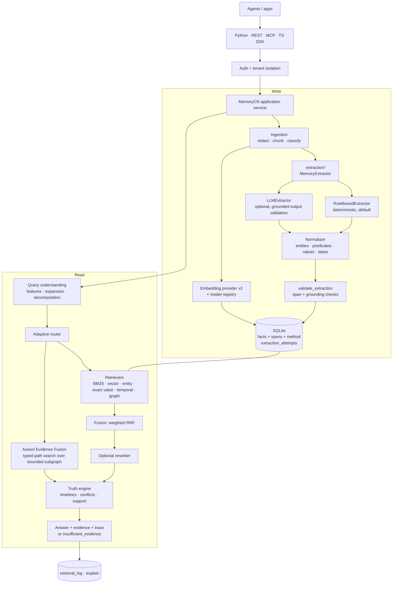

# v0.2 Architecture

A modular monolith. v0.2 adds four packages and extends storage additively; nothing is split into services.

## New and changed modules

| Module | Responsibility | Depends on |
|---|---|---|
| `extraction/schema.py` | Pydantic `StructuredFact`, `SourceSpan`, `ExtractionResult`, `ExtractionAttempt` | none |
| `extraction/values.py` | Parse numbers, lakh/crore/k/m, `LPA`, currency, period → canonical `value_key` | none |
| `extraction/rules.py` | `RuleBasedExtractor`: v0.1 rules plus negation, corrections, conjunctions, bare attributes, spans | schema, values, lexicon |
| `extraction/llm.py` | `LLMExtractor`: prompt, JSON parse, grounding validation, retries, fallback | schema, providers.base |
| `extraction/validate.py` | `validate_extraction` shared by all extractors | schema |
| `providers/base.py` | `EmbeddingProvider` v2 base class, `ModelInfo`, `HealthStatus`, adapter for legacy providers | numpy |
| `retrieval/expansion.py` | `ExpandedQuery`: original preserved; synonyms, aliases, predicate hints, dates | lexicon |
| `retrieval/entity.py` | Entity retriever (mentions + aliases), exact identifier/value retriever | storage |
| `retrieval/fusion.py` | Weighted RRF with configurable `k`, strategy and weights | none |
| `retrieval/rerank.py` | Reranker stage + `CrossEncoderReranker`, `HttpReranker` | providers |
| `fusion/` | `decompose`, `subgraph`, `chain`: typed path search and step validation | retrieval.facts, truth.timeline |
| `store.py`, `engine.py`, `recall.py` | Persist new columns; call extractor; `reembed()`, `rebuild_facts()`; `fusion` strategy | all of the above |

## Storage changes (migration 2, additive)

| Table | Change |
|---|---|
| `facts` | `polarity`, `extraction_method`, `extractor_version`, `source_span_start`, `source_span_end`, `value_num`, `value_unit`, `value_currency` (nullable / defaulted) |
| `embeddings` | `provider`, `model_version`, `normalization`, `created_at`, `status` |
| `embedding_models` (new) | Registry: `model` PK, `provider`, `version`, `dim`, `normalization`, `first_seen_at`, `status` |
| `extraction_attempts` (new) | One row per attempt: method, status (`ok`/`rejected`/`error`/`fallback`), error, proposed vs accepted counts, latency |

Existing v0.1 rows get explicit defaults (`extraction_method='rules-v1'`, `polarity='affirmed'`, `status='ready'`) so provenance is never blank.

## Invariants

1. Original text is never modified; every fact's span indexes into `memories.original_content`.
2. A fact accepted from any extractor passes `validate_extraction`.
3. Facts are equal only if entity, predicate, canonical value (incl. currency and period) and validity agree; embedding similarity never merges facts.
4. Vectors from different models are never compared; the registry enforces one dimension per model name.
5. The original query is always preserved and logged; expansions are additive and weighted lower.
6. Every inference step in a fused answer is a stored, currently valid fact with provenance. Ambiguity and conflict are returned as such.
